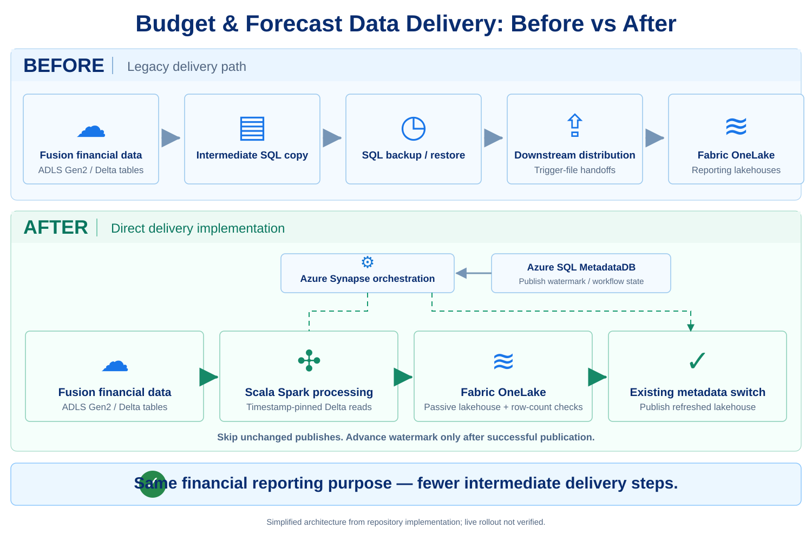

# Financial Data Pipeline Modernization Using Microsoft Fabric

Modernizing enterprise budget and forecast data delivery with **Azure Synapse**, **Scala/Spark**, **Delta Lake**, **Microsoft Fabric OneLake**, and **Azure SQL metadata orchestration**.

## Architecture: Before vs. After

The modernized design removes unnecessary intermediate SQL copy, backup/restore, and trigger-file handoff steps. Azure Synapse orchestrates direct Spark processing of financial Delta data into Fabric OneLake, while Azure SQL MetadataDB tracks publication state and watermarks.

### Before — legacy delivery

Fusion financial data (ADLS Gen2 / Delta tables) → Intermediate SQL copy → SQL backup/restore → downstream distribution → Fabric OneLake reporting lakehouses.

### After — direct delivery

Fusion financial data (ADLS Gen2 / Delta tables) → Scala Spark processing (timestamp-pinned Delta reads) → Fabric OneLake (passive lakehouse and row-count checks) → existing metadata switch to publish the refreshed lakehouse.

Azure Synapse coordinates processing, and Azure SQL MetadataDB manages workflow state and publication watermarks. Unchanged data can be skipped; the watermark advances only after successful publication.

**Goal:** Preserve the same budget and forecast reporting purpose with fewer intermediate delivery steps.

> **Status:** This diagram describes a simplified target architecture. Live rollout and production results are not verified by this repository.
